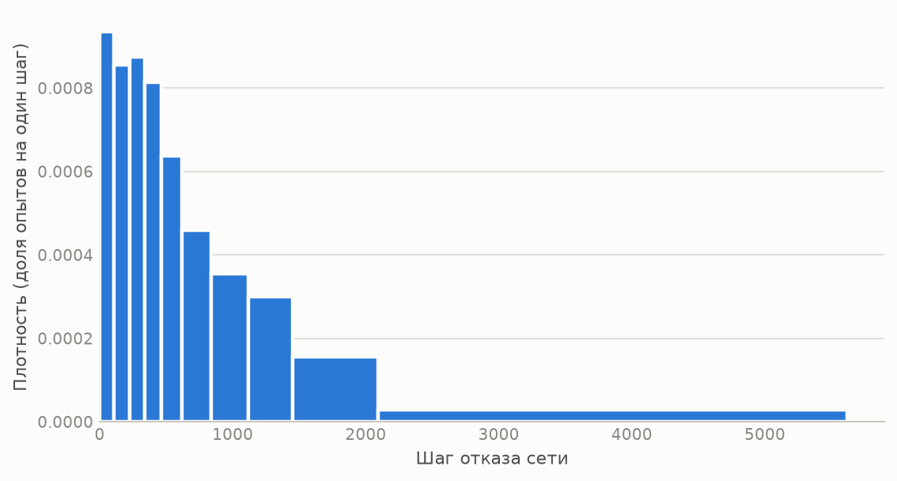
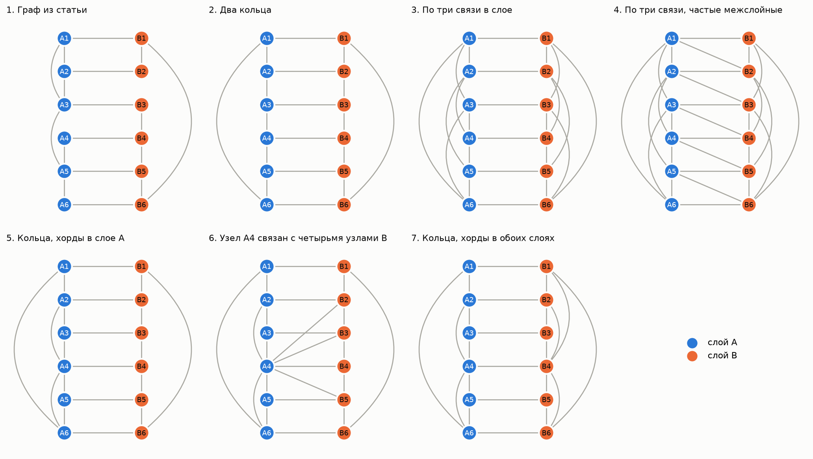
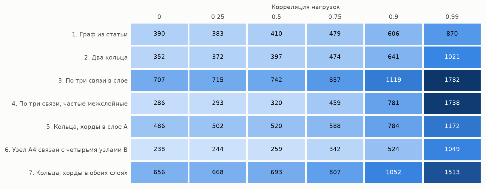
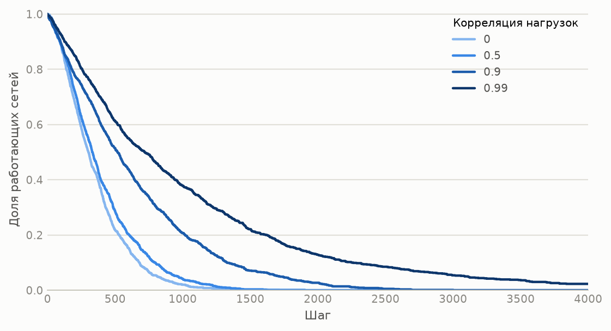
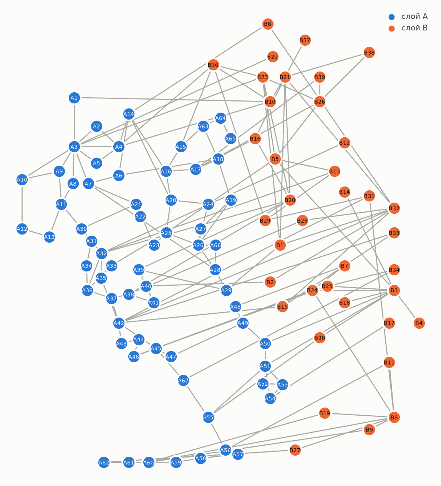

# Моделирование риска каскадных отказов в двухуровневых сетевых системах

Имитационная модель на Python, которая методом Монте-Карло оценивает, через сколько шагов
откажет сеть из двух взаимозависимых слоёв, и показывает, как на это влияют топология сети
и корреляция нагрузок на узлы.

Выпускная квалификационная работа, УрФУ, направление «Прикладная математика», 2026.

**Стек:** Python 3.11+, NumPy, pandas, Matplotlib, pytest.

## Главные результаты

Расчёты на сетях из 12 узлов, 1000 опытов на сценарий:

- **Корреляция нагрузок.** При росте корреляции от 0 до 0,99 среднее время до отказа сети
  увеличивается в 2,2–6,1 раза в зависимости от топологии. До корреляции 0,5 оно почти
  не меняется (не более чем на 13%), основной рост приходится на значения выше 0,75.
- **Связи внутри слоя.** Сети, в которых у каждого узла три связи в своём слое, живут
  примерно вдвое дольше колец: 707 шагов против 352 при независимых нагрузках.
- **Связи между слоями.** Пять дополнительных межслойных связей сокращают время до отказа
  в 2,5 раза (с 707 до 286 шагов) при независимых нагрузках. В такой сети отказ одного узла
  выводит из строя все 12 узлов за один каскад.

## Модель

Сеть состоит из двух слоёв, A и B. Примером может служить энергосистема и сеть связи,
которая ею управляет. Узлы соединены связями внутри слоя и между слоями.

**Порог узла.** У каждого узла есть порог устойчивости, который растёт с числом связей:

```
порог = базовый уровень + d_own · (число связей внутри слоя) + d_AB · (число межслойных связей)
```

**Нагрузки.** На каждом шаге генерируется вектор нагрузок $x \sim N(0, C)$, где $C$ — матрица
корреляций. Для этого матрица раскладывается по Холецкому, $C = LL^T$, и вектор независимых
стандартных нормальных величин $u$ преобразуется в $x = Lu$.

**Отказ узла.** Узел отказывает, если $|x_i|$ превышает его порог.

**Каскад.** Вместе с узлом отказывают все связанные с ним узлы другого слоя, затем их соседи
из первого слоя, и так далее. Соседи по своему слою продолжают работать, но теряют связь,
поэтому их порог снижается и следующий отказ становится вероятнее.

**Отказ сети.** Опыт заканчивается, когда выполняется выбранный критерий:

| Режим | Критерий |
|---|---|
| 1 | в обоих слоях осталось меньше минимального числа работающих узлов |
| 2 | сеть распалась на две и более части |
| 3 | выполнено любое из двух условий |

**Статистика.** Опыт повторяется M раз. По шагам отказа считаются среднее, дисперсия, СКО,
медиана и границы интервала, в который попадают 95% опытов: с каждого края вариационного
ряда отбрасывается по 2,5% значений.

## Быстрый старт

```bash
git clone https://github.com/mishlaw/cascade-failure-risk.git
cd cascade-failure-risk
python -m venv .venv
source .venv/bin/activate        # Windows: .venv\Scripts\activate
pip install -r requirements.txt

python main.py --seed 42         # один расчёт по файлу data/params.xlsx
python experiments.py            # все эксперименты из раздела ниже, несколько минут
pytest                           # тесты
```

Вывод `python main.py --seed 42`:

```
Сеть: узлов 6 + 6, связей 23
Опытов: 1000, шагов в опыте: до 10000, режим отказа: 3, принудительный отказ узла: A1
Опытов всего:              1000
Опытов с отказом сети:     1000
Опытов без отказа:         0
Мат. ожидание шага отказа: 910.1
Медиана:                   619.0
Дисперсия:                 791906.8
СКО:                       889.9
Границы 95%-го интервала:  34 .. 3410
```

Ключ `--figures папка` дополнительно сохраняет схему сети и гистограмму шага отказа.

## Параметры

Параметры, матрица смежности и матрица корреляций задаются в `data/params.xlsx`
на листах «Параметры», «Смежности» и «Корреляции».

| Параметр в файле | В коде | Значение | Смысл |
|---|---|---|---|
| `n_A`, `n_B` | `n_a`, `n_b` | 6, 6 | число узлов в слоях A и B |
| `N` | `n_steps` | 10 000 | максимальная длительность одного опыта, шагов |
| `M` | `n_runs` | 1000 | число опытов Монте-Карло |
| `Alevel`, `Blevel` | `level_a`, `level_b` | 3, 3 | базовый порог узлов слоёв A и B |
| `d(A)`, `d(B)` | `d_a`, `d_b` | 0,15 | прибавка к порогу за каждую связь внутри слоя |
| `d(AB)` | `d_ab` | 0,1 | прибавка к порогу за каждую межслойную связь |
| `KlFunc_A`, `KlFunc_B` | `min_alive_a`, `min_alive_b` | 3, 3 | минимальное число работающих узлов в слое |
| `Режим отказа` | `fail_mode` | 3 | критерий отказа сети |
| `Num_Node` | `forced_node` | A1 | узел, который отказывает в начале каждого опыта; 0, если такого узла нет |

## Эксперименты

Все числа ниже получены командой `python experiments.py` с зерном генератора 42.
Таблицы лежат в `results/`, рисунки в `figures/`. Погрешность среднего в каждом сценарии
не превышает 3,2% (стандартная ошибка по 1000 опытов).

### 1. Базовый сценарий

Сеть и параметры из `data/params.xlsx`: топология 6 из списка ниже, корреляция нагрузок 0,99,
в начале каждого опыта отказывает узел A1.

| Показатель | Значение |
|---|---|
| Среднее время до отказа | 910 шагов |
| Медиана | 619 шагов |
| СКО | 890 шагов |
| 95% опытов | от 34 до 3410 шагов |
| Опытов без отказа за 10 000 шагов | 0 из 1000 |

Распределение сильно скошено вправо: половина сетей отказывает за 619 шагов, а самые
живучие 10% работают от 2092 до 5617 шагов. На децильной гистограмме каждый столбец
содержит 10% опытов.



### 2. Топология и корреляция нагрузок

Семь сетей по 6 узлов в слое. Топология 1 взята из статьи [указать источник].



Для каждой сети корреляция нагрузок между любыми двумя узлами задавалась одинаковой:
от 0 до 0,99. Принудительного отказа нет. На рисунке показано среднее время до отказа сети в шагах.



Что из этого следует:

1. **Чем выше корреляция, тем позже отказывает сеть.** Порог задан в единицах стандартного
   отклонения нагрузки, поэтому вероятность отказа отдельного узла на шаге от корреляции
   не зависит. При независимых нагрузках узлы превышают пороги на разных шагах, и сеть
   получает удары часто. При сильной корреляции превышения совпадают по времени, и событий
   становится меньше.
2. **Связи внутри слоя повышают живучесть.** Топологии 3 и 7 лидируют при любой корреляции
   до 0,9: дополнительные связи поднимают пороги и не дают сети распасться.
3. **Межслойные связи опасны при слабой корреляции.** Топология 4 отличается от топологии 3
   пятью межслойными связями и при независимых нагрузках живёт в 2,5 раза меньше.
   Топология 6 отличается от топологии 5 тремя межслойными связями узла A4 и живёт
   вдвое меньше: 238 шагов против 486. При корреляции 0,99 разница между топологиями 3 и 4
   исчезает: 1782 и 1738 шагов.

Кривые выживания для топологии 2 показывают то же самое по шагам: доля сетей,
которые ещё работают.



### 3. Принудительный отказ узла

Тот же расчёт, но в начале каждого опыта отказывает узел A1.

- В топологии 4 сеть отказывает сразу, на шаге 0, во всех 1000 опытах при любой корреляции:
  цепочка межслойных связей выводит из строя все 12 узлов.
- В остальных топологиях среднее время до отказа при независимых нагрузках сокращается
  на 13–32%.

### 4. Сеть из 105 узлов

Сеть из 67 узлов слоя A и 38 узлов слоя B, 166 связей, из них 36 межслойных.
В исходных данных слой B содержит 39 узлов, но узел B35 не имеет связей и в расчёте
не участвует. Топология взята из [указать источник]. Параметры те же, что в базовом
сценарии; слой считается отказавшим, когда в нём работает меньше половины узлов.



| Корреляция нагрузок | 0 | 0,25 | 0,5 | 0,75 | 0,9 | 0,99 |
|---|---|---|---|---|---|---|
| Среднее время до отказа, шагов | 72 | 80 | 95 | 151 | 257 | 589 |
| Медиана, шагов | 57 | 65 | 72 | 111 | 182 | 384 |

Большая сеть отказывает в несколько раз быстрее малых: у 48 узлов из 105 не больше двух
связей, и отказ одного соседа часто отрезает такой узел от сети. Зависимость от корреляции
та же, что на малых сетях: рост в 8,2 раза между корреляцией 0 и 0,99.

## Структура репозитория

```
cascade/
    graph.py         двухуровневая сеть: узлы, связи, загрузка из матрицы и списка связей
    simulation.py    модель: пороги, каскад, критерии отказа, Монте-Карло
    stats.py         статистика шага отказа, децили, кривая выживания
    excel_io.py      чтение параметров и матриц из Excel
    plots.py         рисунки
data/
    params.xlsx      параметры базового сценария
    topologies/      семь сетей на 12 узлов, списки связей
    network_106/     сеть 67 + 39 узлов: связи и координаты узлов для рисунка
results/             таблицы с результатами экспериментов
figures/             рисунки
tests/               тесты модели
main.py              один расчёт по файлу параметров
experiments.py       серия экспериментов из этого README
```

## Тесты

`pytest` запускает 13 тестов: расчёт порогов, распространение каскада по межслойным связям,
критерии отказа сети, корреляция сгенерированных нагрузок, воспроизводимость по зерну
генератора, статистика и загрузка файла параметров.

## Автор

Инна Артеменко, [github.com/mishlaw](https://github.com/mishlaw)
